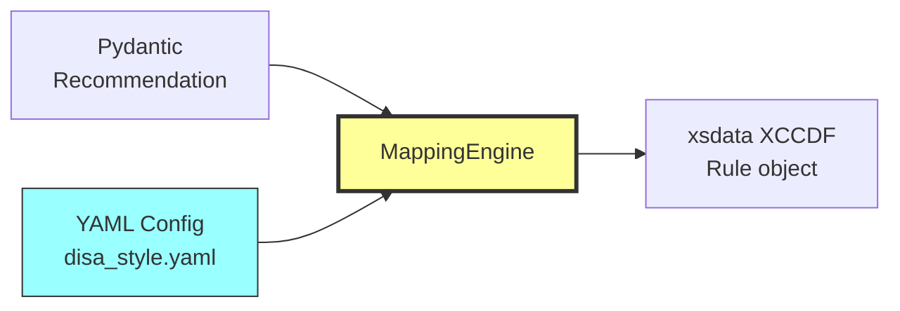

# MappingEngine User Guide

**Practical guide to working with the configuration-driven XCCDF transformation system**

!!! info "Documentation Path"
**You are here:** Developer Guide > MappingEngine User Guide

**New to terms?** See [Glossary](../about/glossary.md) for definitions of MappingEngine, YAML, transformation, field mapping, xsdata, etc.

!!! success "December 2025 Update"
**Generic Structure Handlers:** The MappingEngine now uses 3 generic handlers that work for ANY compliance framework:

- `ident_from_list` - Any index/taxonomy (CCI, MITRE, PCI-DSS, etc.)
- `metadata_from_config` - Any nested XML structure
- `generate_profiles_from_rules` - Any applicability system

**Adding PCI-DSS, ISO 27001, HIPAA:** YAML config only (no code changes)
See [Adding PCI-DSS Guide](adding-pci-dss.md)

---

## What is the MappingEngine?

The [MappingEngine](../about/glossary.md#mappingengine) is a **[config-driven](../about/glossary.md#config-driven) [transformation](../about/glossary.md#transformation) system** that converts CIS [Benchmark](../about/glossary.md#benchmark) data ([Pydantic models](../about/glossary.md#pydantic-model)) into [XCCDF](../about/glossary.md#xccdf) XML format using YAML configuration files.

**Think of it as:** A translator that reads instructions from a YAML file and transforms data from one [format](../about/glossary.md#format) to another - without writing code.



**Key Benefit:** Change XCCDF output structure by editing YAML, not Python code.

---

## Quick Example

**Problem:** You want to change how the description field appears in XCCDF.

**Without MappingEngine (hard-coded):**
```python
# exporters/xccdf_disa_exporter.py (BAD - don't do this)
def map_description(recommendation):
desc = f"<VulnDiscussion>{recommendation.description}</VulnDiscussion>"
desc += f"<FalsePositives></FalsePositives>"
# ... 50 more lines of string manipulation
return desc
```

**With MappingEngine (config-driven):**
```yaml
# exporters/configs/disa_style.yaml (GOOD - do this)
description:
structure: "embedded_xml_tags"
components:

- tag: "VulnDiscussion"
sources:

- field: "description"
separator: "\n\n" # follows the description when the rationale has text

- field: "rationale"

- tag: "FalsePositives"
content: ""
```

**Result:** Same output, but now you can:

- Change structure without touching code
- Support multiple XCCDF styles
- Test configurations independently
- Reuse transformations across styles

---

## YAML Configuration Structure

### Complete Example (Simplified)

```yaml
# my_custom_style.yaml

# Inherit base configuration
extends: base_style.yaml

# Style metadata
metadata:
style_name: "custom"
xccdf_version: "1.2"
description: "My custom XCCDF format"

# Benchmark-level settings
benchmark:
id_template: "xccdf_custom_benchmark_{version}_{title_slug}"
title:
source: "title"
transform: "none"

# Rule-level field mappings
field_mappings:
title:
target_element: "title"
source_field: "title"
transform: "none"

description:
target_element: "description"
source_field: "description"
transform: "none"

ident:
target_element: "ident"
multiple: true
cci_lookup:
source_field: "cis_controls"
extract: "all"
```

### Configuration Sections

| Section | Purpose | Required |
|---------|---------|----------|
| `metadata` | Style identification and XCCDF version | Yes |
| `benchmark` | Benchmark-level elements and namespaces (`benchmark.namespaces`) | Yes |
| `field_mappings` | Rule-level field transformations | Yes |
| `rule_defaults` | Default attributes for all rules | No |
| `validation` | Validation rules and constraints | No |
| `post_processing` | Handlers (`metadata_injection`) and `override` attribute removal after serialization | No |

### Benchmark ID

`benchmark.id_template` names the `<Benchmark>` element. It is required: a style
without one fails with `ExportError` at export time. The engine substitutes three
variables:

| Variable | Value |
|----------|-------|
| `{benchmark_id}` | CIS WorkBench benchmark ID, as stored (e.g. `23598`) |
| `{version}` | `benchmark.version` reduced to an NCName-safe segment (`v1.0.0` stays `v1.0.0`; `v7.1.0 (vNext)` becomes `v7.1.0_vNext`) |
| `{title_slug}` | `benchmark.title` with every run of whitespace or other non-NCName characters replaced by one `_` (`CIS Ubuntu Linux 22.04 LTS Benchmark` becomes `CIS_Ubuntu_Linux_22.04_LTS_Benchmark`) |

The two shipped styles:

```yaml
# cis.yaml — the form CIS publishes:
# xccdf_org.cisecurity.benchmarks_benchmark_1.0.0_CIS_Ubuntu_Linux_22.04_LTS_Benchmark
id_template: "xccdf_org.cisecurity.benchmarks_benchmark_{version}_{title_slug}"

# disa.yaml — short form; Vulcan shows it in the STIG ID column
id_template: "CIS_{benchmark_id}"
```

XCCDF 1.2 requires Benchmark ids to match `xccdf_<namespace>_benchmark_<name>` and
to be an NCName, so a 1.2 style's template must start with `xccdf_`, contain
`_benchmark_`, and use only the variables above after it.

---

## Field Mapping Types

The MappingEngine supports 4 field mapping strategies:

### 1. Simple Field Mapping

**Use when:** Direct 1:1 field mapping with optional transformation

```yaml
title:
target_element: "title" # XCCDF element name
source_field: "title" # Pydantic model field
transform: "none" # Transformation to apply; the text is Markdown, written as it is
xccdf_type: "TextType" # xsdata type (optional)
```

**Example:**
```python
# Input (Pydantic)
recommendation.title = "Ensure `cramfs` is disabled"

# Config applies transform
transform = "none"

# Output (xsdata)
Rule.title = TextType(value="Ensure `cramfs` is disabled")
```

### 2. Composite Field Mapping

**Use when:** Combine multiple source fields into one XCCDF element. Each source's text
(after its transform, `none` by default) is joined by the separator (a blank line by
default); a source with a `label` writes the label, the separator and the text; a source
without text adds nothing, and an element with no text at all is left out. A source naming
a field or transform that does not exist is refused when the style loads.

```yaml
field_mappings:
  description:
    target_element: "description"
    structure: "composite"
    separator: "\n\n" # Join with double newline
    sources:

      - field: "description"
      - field: "default_value"
        label: "Default Value:"

      - field: "additional_info"
        label: "Additional Information:"
```

**Example:**
```python
# Input (Pydantic)
recommendation.description = "The example filesystem is not needed."
recommendation.default_value = "/etc/example: off"
recommendation.additional_info = None  # an empty source adds nothing, label included

# Output (the Rule's description element, its text escaped once by the serializer)
<description>The example filesystem is not needed.

Default Value:

/etc/example: off</description>
```

### 3. Embedded XML Tags (DISA STIG Format)

**Use when:** Need XML tags inside XCCDF element (like DISA VulnDiscussion)

```yaml
description:
target_element: "description"
structure: "embedded_xml_tags"
components:

- tag: "VulnDiscussion"
sources:

- field: "description"
separator: "\n\n" # follows the description when the rationale has text

- field: "rationale"

- tag: "FalsePositives"
content: "" # Empty (DISA legacy)

- tag: "PotentialImpacts"
sources:

- field: "impact"
```

Every tag is written in the order given, empty when the rule has no text for it, as DISA
writes them. Each tag is built and written by the XML library (lxml), which escapes its text,
so a reader that unescapes the description once and parses the tags gets the stored text,
placeholders such as `<user>` included (the serializer escapes the whole description once more
on write); a tag name that is no XML name is refused when the style loads.

**Example:**
```python
# Output (xsdata)
Rule.description = HtmlTextWithSubType(
value="<VulnDiscussion>The cramfs filesystem...\n\n"
"Removing support reduces...</VulnDiscussion>"
"<FalsePositives></FalsePositives>"
"<PotentialImpacts>Minimal impact...</PotentialImpacts>"
)
```

**Rendered XML:**
```xml
<description>
<VulnDiscussion>The cramfs filesystem is a compressed read-only filesystem...

Removing support for unneeded filesystem types reduces attack surface.</VulnDiscussion>
<FalsePositives></FalsePositives>
<PotentialImpacts>Minimal impact expected.</PotentialImpacts>
</description>
```

(In the file the serializer escapes the description's text once, so the tags appear as `&lt;VulnDiscussion&gt;...`; shown unescaped here.)

### 4. List Field Mapping

**Use when:** Create multiple XCCDF elements from a list (like CCI identifiers)

```yaml
ident:
target_element: "ident"
multiple: true # Creates one <ident> per CCI
cci_lookup:
enabled: true
source_field: "cis_controls"
extract: "all"
deduplicate_nist: true
attributes:
system: "http://cyber.mil/cci"
```

**Example:**
```python
# Input (Pydantic)
recommendation.cis_controls = [
CISControl(version=8, control="4.1", ...),
CISControl(version=8, control="4.8", ...),
]

# CCI lookup (every CCI of each safeguard, primary first)
# 4.1 ["CCI-003941", "CCI-000290", "CCI-003906", "CCI-003909"]
# 4.8 ["CCI-001762", "CCI-000382", "CCI-000381", "CCI-000384"]

# Each CCI once (two safeguards can share one)
ccis = ["CCI-003941", "CCI-000290", "CCI-003906", "CCI-003909",
"CCI-001762", "CCI-000382", "CCI-000381", "CCI-000384"]

# Output (xsdata)
Rule.ident = [
IdentType(value="CCI-003941", system="http://cyber.mil/cci"),
IdentType(value="CCI-000290", system="http://cyber.mil/cci"),
# ... one IdentType per CCI above, in that order
]
```

**Rendered XML:**
```xml
<ident system="http://cyber.mil/cci">CCI-001234</ident>
<ident system="http://cyber.mil/cci">CCI-000381</ident>
<ident system="http://cyber.mil/cci">CCI-000382</ident>
```

---

## Available Transformations

Transforms are registered in `mapping_engine.py` (`TransformRegistry.register`) and named
by a mapping's `transform`. A benchmark's text fields hold Markdown (see the
[data model](../technical-reference/data-model.md)) and every export writes it as it is, so
the shipped styles name `none` for text; there is no HTML conversion (a text parsed as HTML
would lose a placeholder such as `<user>`).

### none
Pass through unchanged (no transformation).

```yaml
version:
source_field: "version"
transform: "none"
```

---

## Variable Substitution

Use `{variable}` syntax to insert dynamic values:

### Available Variables

**In rule templates** (the `rule_id` and `group_id` templates, and the attribute
templates of a rule's field mappings such as `fixref` and `system`):

- `{ref}` - Recommendation number (e.g., "1.1.1")
- `{ref_normalized}` - Underscored version (e.g., "1_1_1")
- `{stig_number}` - Zero-padded form for DISA ids (e.g., "010101")
- `{rec.<field>}` - Any field of the recommendation (e.g., `{rec.title}`); attribute
  templates only, not the id templates, which see the ref's three values alone

- `{benchmark.<field>}` - Any field of the benchmark; attribute templates only

A rule's templates see exactly these values, not the engine's working state.

A name the template's context does not have stops the export (one strict substituter
fills every template), so a typo cannot write an empty part.

**From Benchmark:**

- `{benchmark.title}` - Benchmark title
- `{benchmark.version}` - Benchmark version
- `{benchmark.url}` - Benchmark URL
- `{benchmark_id}` - Numeric ID

**Benchmark ID template only** (see [Benchmark ID](#benchmark-id)):

- `{version}` - Benchmark version reduced to an NCName-safe segment
- `{title_slug}` - Benchmark title reduced to an NCName-safe segment

**Generated:**

- `{download_date}` - Current date

### Example: Dynamic Attributes

```yaml
fixtext:
target_element: "fixtext"
source_field: "remediation"
transform: "none"
attributes:
fixref: "F-{ref_normalized}" # F-1_1_1, F-1_1_2, etc.
```

**Result:**
```xml
<fixtext fixref="F-1_1_1">Run: modprobe -n -v cramfs</fixtext>
<fixtext fixref="F-2_3_5">Edit /etc/ssh/sshd_config</fixtext>
```

---

## CCI Lookup Configuration

CCI (Control Correlation Identifier) lookup is a special feature for DISA compliance:

### Basic CCI Lookup

```yaml
ident:
target_element: "ident"
multiple: true
cci_lookup:
enabled: true
mapping_file: "data/cis-cci-mapping.json"
source_field: "cis_controls" # Look up CCIs from CIS Controls
extract: "all" # "all" or "primary"
deduplicate_nist: true # Write cited NIST controls as references unless a CCI restates them
attributes:
system: "http://cyber.mil/cci"
```

### Extract Options

**`extract: "all"`** (the DISA style's setting)

- Every CCI the mapping file gives the safeguard, primary first
- The export is a transform: what the mapping has, the rule carries; a wrong CCI is fixed
  in `cis-cci-mapping.json`, not filtered here

**`extract: "primary"`**

- Only the first (primary) CCI of each safeguard

### Example: CCI Lookup Flow

```python
# Input: the recommendation's CIS Controls of the mapping file's version (v8)
recommendation.cis_controls = [CISControl(version=8, control="4.8", ...)]
recommendation.nist_controls = ["CM-7", "SI-3"]

# Step 1: each safeguard's CCIs, from cis-cci-mapping.json (OFFICIAL entries only)
# 4.8 -> CCI-001762 [CM-7 (1) (b)], CCI-000382 [CM-7 b], CCI-000381 [CM-7 a],
#        CCI-000384 [CM-7 (1) (a)]

# Step 2: the control and enhancement each CCI sits under
# {"CM-7(1)", "CM-7"}

# Step 3: cited controls no CCI restates exactly
# "CM-7" is restated (CCI-000382 sits under CM-7 b); "SI-3" is not

# Output
Rule.ident = [IdentType(value=cci) for cci in ccis]        # the four CCIs
Rule.reference = [ReferenceType(... dc:identifier "SI-3")]  # the one reference
```

---

## How to Add a New Field to XCCDF

**Scenario:** You want to add the "default_value" field to XCCDF output.

### Step 1: Check Pydantic Model

Verify the field exists:

```python
# src/cis_bench/models/benchmark.py
class Recommendation(BaseModel):
# ...
default_value: Optional[str] = None # Field exists
```

### Step 2: Choose XCCDF Element

Decide where it belongs in XCCDF. Options:

- New `<default>` element
- Add to existing `<description>` with custom tag
- Add as metadata

Let's add as a new element:

### Step 3: Update YAML Config

```yaml
# src/cis_bench/exporters/configs/disa_style.yaml

field_mappings:
# ... existing mappings

default_value: # New mapping
target_element: "default"
source_field: "default_value"
transform: "none"
optional: true # Only include if field has value
xccdf_type: "TextType"
```

### Step 4: Test the Change

```bash
# Export with new config
cis-bench export 23598 --format xccdf --style disa -o test.xml

# Check output
grep "<default>" test.xml
```

**Result:**
```xml
<Rule id="xccdf_rule_1_1_1">
<title>Ensure mounting of cramfs is disabled</title>
<description>...</description>
<default>Not applicable - module should not be loaded</default>
<ident>...</ident>
</Rule>
```

**That's it!** No Python code changes needed.

---

## How to Create a New XCCDF Style

**Scenario:** You want to create a "minimal" XCCDF style with only essential fields.

### Step 1: Create New Config File

```bash
# Create new style config
touch src/cis_bench/exporters/configs/minimal_style.yaml
```

### Step 2: Define Configuration

```yaml
# src/cis_bench/exporters/configs/minimal_style.yaml

# Inherit base
extends: base_style.yaml

# Style metadata
metadata:
style_name: "minimal"
description: "Minimal XCCDF with only essential fields"
xccdf_version: "1.2"
xccdf_namespace: "http://checklists.nist.gov/xccdf/1.2"

# Benchmark settings
benchmark:
id_template: "xccdf_minimal_benchmark_{benchmark_id}"

title:
source: "title"
transform: "none"

description:
source: "title"
prepend_text: "CIS Benchmark - Minimal Export. "

version:
source: "version"

# Rule-level field mappings (minimal set)
field_mappings:
title:
target_element: "title"
source_field: "title"
transform: "none"

description:
target_element: "description"
source_field: "description"
transform: "none"

# Just one check element (simplified)
check:
target_element: "check"
structure: "nested"
attributes:
system: "urn:cis:check"
children:

- element: "check-content"
source_field: "audit"
transform: "none"
```

### Step 3: Register in Exporter

```python
# src/cis_bench/exporters/xccdf_unified_exporter.py

SUPPORTED_STYLES = {
'disa': 'configs/disa_style.yaml',
'cis': 'configs/cis_style.yaml',
'minimal': 'configs/minimal_style.yaml' # Add this line
}
```

### Step 4: Test Your New Style

```bash
# Export with new style
cis-bench export 23598 --format xccdf --style minimal -o minimal.xml

# Verify output
less minimal.xml
```

**That's it!** You've created a new XCCDF style without modifying transformation logic.

---

## Working with Config Inheritance

### Base Style Pattern

```yaml
# base_style.yaml - Common configuration (no namespaces: each style declares its own)
rule_defaults:
  severity: "medium"
```

### Child Style Inherits

```yaml
# disa_style.yaml
extends: base_style.yaml # Inherit all from base

# Override specific settings
metadata:
  xccdf_version: "1.1.4" # Override (base has 1.2)

# The namespaces this style's documents use, declared on the root by the serializer
benchmark:
  namespaces:
    default: "http://checklists.nist.gov/xccdf/1.1"
    dc: "http://purl.org/dc/elements/1.1/"

# field_mappings are merged (not replaced)
field_mappings:
  title:
    target_element: "title"
    source_field: "title" # transform: none, the text as stored
```

**Inheritance Rules:**
Every section is inherited the same way. Mappings merge key by key, and the child's value
wins where both set one; a list or a single value in the child replaces the parent's.
So a child adds to or overrides `field_mappings`, `metadata`, `rule_defaults`,
`benchmark` (including `benchmark.namespaces`) and `post_processing`, while a child that
sets `post_processing.handlers` replaces the parent's list of handlers. The transforms a
mapping may name are the ones registered in `mapping_engine.py` (`TransformRegistry`),
not a section of the style; a style that carries a top-level section the loader does not
read, or a `post_processing` setting the exporter does not read, is refused when it loads,
with its name.

A child can add a namespace but cannot drop one it inherits, and the serializer declares
every namespace in `benchmark.namespaces` on the root. So namespaces belong to the style
whose documents use them, not to a shared base: the shipped `base.yaml` declares none.

---

## Advanced Features

### Conditional Mapping

Map fields only when certain conditions are met:

```yaml
impact_statement:
target_element: "impact"
source_field: "impact"
transform: "none"
optional: true # Only include if field has value
condition:
field: "impact"
not_empty: true # Only map if field is not empty/None
```

### Nested Structures

Create nested XCCDF elements:

```yaml
check:
target_element: "check"
structure: "nested"
attributes:
system: "C-{ref_normalized}"
children:

- element: "check-content-ref"
attributes:
name: "oval:check:{ref_normalized}:def:1"
href: "oval-definitions.xml"

- element: "check-content"
source_field: "audit"
transform: "none"
```

**Output:**
```xml
<check system="C-1_1_1">
<check-content-ref
name="oval:check:1_1_1:def:1"
href="oval-definitions.xml"/>
<check-content>Run: modprobe -n -v cramfs</check-content>
</check>
```

### Custom Metadata Blocks

Add CIS Controls as structured metadata:

```yaml
cis_controls_metadata:
  structure: "metadata_from_config"
  requires_post_processing: true
  source_field: "cis_controls"
  metadata_spec:
    root_element: "cis_controls"
    namespace: "http://cisecurity.org/controls"
    group_by: "item.version"
    group_element:
      element: "framework"
      attributes:
        urn: "urn:cisecurity.org:controls:{group_key}"
      item_element:
        element: "safeguard"
        # ... (see cis_style.yaml for complete spec)
```

**Output:**
```xml
<metadata>
<controls:control id="4.1" version="8" ig="IG1">
Establish and Maintain Secure Configuration Process
</controls:control>
<controls:control id="4.8" version="8" ig="IG2">
Uninstall or Disable Unnecessary Services
</controls:control>
</metadata>
```

### Dublin Core references

A reference's Dublin Core children (`dc_elements` on a `dublin_core` field, or on
`benchmark.reference`) are built by `MappingEngine.dublin_core_elements` as xsdata
`AnyElement` instances: qualified name from the prefix's namespace in
`benchmark.namespaces`, text from the filled `content` template. `ReferenceType.content`
is a wildcard (`##any`, mixed) in both XCCDF 1.1.4 and 1.2, so xsdata serializes them as
child elements; the final namespace pass then declares `dc` once at the root. No
post-processing handler is involved.

### Post-processing: metadata injection

Elements marked `requires_post_processing: true` are built as lxml elements and
inserted into the serialized XML by the `metadata_injection` handler, which a
style enables under `post_processing.handlers`:

```yaml
post_processing:
  handlers: [metadata_injection]
```

Where the `<metadata>` lands is not configured. XCCDF fixes the order of a
Rule's children, and the xsdata models in `cis_bench.models` are generated from
the NIST schemas, so the exporter asks `MappingEngine.rule_element_order()` for
the element sequence of the style's XCCDF version and inserts metadata before
the first child the schema places after it (`rationale`, `platform`, `requires`,
`conflicts`, `ident`, `impact-metric`, `profile-note`, `fixtext`, `fix`, `check`,
`complex-check`, `signature` in 1.2). The schema is the single source of that
order; there is no list to keep in sync.

Two conditions stop an export with `ExportError`:

- **Duplicate Rule ids.** Metadata is keyed by Rule id, and XCCDF requires ids
  to be unique, so two recommendations whose `rule_id` template yields the same
  id are reported with their refs and titles. No file is written.

- **A version without Rule metadata.** XCCDF 1.1.4 allows `<metadata>` only on
  the Benchmark, not inside a Rule, so enabling `metadata_injection` on a 1.1.4
  style (such as DISA) is a configuration error.

---

## Real-World Example: Complete Field Mapping

Let's walk through mapping the `fixtext` element for DISA STIG:

### DISA STIG Requirement

```xml
<fixtext fixref="F-1_1_1">
Edit /etc/modprobe.d/cramfs.conf and add:
install cramfs /bin/true
</fixtext>
```

**Requirements:**

1. Element name: `fixtext`
2. Attribute: `fixref` with format "F-{ref_normalized}"
3. Content: the stored remediation text (Markdown, written as it is)
4. Type: FixTextType (xsdata)

### YAML Configuration

```yaml
fixtext:
target_element: "fixtext" # 1. Element name
source_field: "remediation" # Source from Pydantic
transform: "none" # 3. The stored Markdown, as it is
attributes: # 2. Dynamic attribute
fixref: "F-{ref_normalized}"
xccdf_type: "FixTextType" # 4. xsdata type
```

### MappingEngine Process

```python
# 1. Load config
config = field_mappings['fixtext']

# 2. Get source data (the stored text is Markdown)
source_value = getattr(recommendation, 'remediation')
# "Edit `/etc/modprobe.d/cramfs.conf` and add:\n\n```\ninstall cramfs /bin/true\n```"

# 3. Apply transformation: none leaves the text as it is
transformed = apply_transform(source_value, 'none')
# "Edit `/etc/modprobe.d/cramfs.conf` and add:\n\n```\ninstall cramfs /bin/true\n```"

# 4. Substitute variables in attributes
ref_normalized = recommendation.ref.replace('.', '_') # "1.1.1" "1_1_1"
fixref_value = f"F-{ref_normalized}" # "F-1_1_1"

# 5. Create xsdata object
fixtext = FixTextType(
value=transformed,
fixref=fixref_value
)

# 6. Add to Rule
rule.fixtext = fixtext
```

### Verification

```bash
# Export and check
cis-bench export 23598 --format xccdf --style disa -o output.xml
grep -A3 "<fixtext" output.xml
```

**Output:**
```xml
<fixtext fixref="F-1_1_1">
Edit `/etc/modprobe.d/cramfs.conf` and add:

```
install cramfs /bin/true
```
</fixtext>
```

---

## Debugging Mapping Issues

### Enable Verbose Logging

```bash
cis-bench --verbose export 23598 --format xccdf --style disa
```

**Logs show:**
```
DEBUG: Loading config: disa_style.yaml
DEBUG: Processing field: title
DEBUG: Source value: "Ensure cramfs disabled"
DEBUG: Applying transform: none
DEBUG: Result: "Ensure cramfs disabled"
DEBUG: Creating TextType object
```

### Common Issues

**Issue: "Field not found"**
```
KeyError: 'custom_field'
```
**Fix:** Add field to Pydantic model or use `optional: true` in config

**Issue: "Invalid xsdata type"**
```
TypeError: Rule.title expects TextType, got str
```
**Fix:** Check `xccdf_type` in config matches xsdata model

**Issue: "CCI lookup returns no results"**
```
WARNING: No CCIs found for CIS Control 18.1
```
**Fix:** none needed when the safeguard is INFERRED or UNMAPPED in `cis-cci-mapping.json`: only OFFICIAL entries give CCIs, and a rule with none gets the fallback CCI

**Issue: "Namespace prefix not declared"**
```
ERROR: Namespace prefix 'controls' not defined
```
**Fix:** Add namespace to `benchmark.namespaces` in config

---

## Testing Your Configuration Changes

### Unit Test Configuration Loading

```python
# tests/unit/test_mapping_config.py

def test_load_custom_style():
"""Test loading custom style config."""
config = load_yaml_config('configs/my_custom_style.yaml')

assert config['metadata']['style_name'] == 'custom'
assert 'title' in config['field_mappings']
```

### Integration Test Export

```python
# tests/integration/test_custom_xccdf.py

def test_custom_style_export(sample_benchmark):
"""Test exporting with custom style."""
exporter = XCCDFUnifiedExporter(style='custom')
xccdf = exporter.export(sample_benchmark)

# Verify structure
assert xccdf.id.startswith('xccdf_custom_benchmark_')
assert len(xccdf.group[0].rule) > 0
```

### Manual Validation

```bash
# Export
cis-bench export 23598 --format xccdf --style custom -o test.xml

# Validate against the XCCDF schema
cis-bench validate test.xml

# Check specific elements
xmllint --xpath "//Rule/title" test.xml
xmllint --xpath "count(//ident)" test.xml
```

---

## Best Practices

### 1. Start from Base Style

Always extend `base_style.yaml`:
```yaml
extends: base_style.yaml # Do not start from scratch
```

### 2. Use Descriptive Names

```yaml
# Good
field_mappings:
vulnerability_discussion:
target_element: "description"

# Bad
field_mappings:
desc:
target_element: "description"
```

### 3. Name a Registered Transform

```yaml
field_mappings:
  version:
    target_element: "version"
    source_field: "version"
    transform: "strip_version_prefix" # registered in mapping_engine.py
```

A transform is Python, registered with `TransformRegistry.register`, and a mapping names it;
a style that names one that is not registered is refused when it loads.

### 4. Test Each Field Mapping

Do not add 10 mappings at once. Add one, test, commit, repeat.

### 5. Use Optional Wisely

```yaml
impact_statement:
source_field: "impact"
optional: true # Good - impact field might not exist

title:
source_field: "title"
optional: false # Good - title is required
```

### 6. Validate xsdata Types

Check the xsdata model to ensure type matches:

```python
# src/cis_bench/models/xccdf_v1_1/__init__.py
class Rule:
title: TextWithSubType # Not TextType!
```

```yaml
# Config must match
title:
xccdf_type: "TextWithSubType" # Matches
```

---

## Configuration File Locations

```
src/cis_bench/exporters/configs/
├── base_style.yaml # Common config (inherit from this)
├── disa_style.yaml # DISA STIG format
├── cis_style.yaml # CIS native format (if exists)
└── custom_style.yaml # Your custom style
```

**Data files:**
```
src/cis_bench/data/
└── cis-cci-mapping.json # CIS Control CCI mappings
```

---

## Example: Minimal Working Config

Here's a complete minimal style that actually works:

```yaml
# minimal_working_style.yaml

extends: base_style.yaml

metadata:
style_name: "minimal"
xccdf_version: "1.2"

benchmark:
id_template: "xccdf_minimal_{benchmark_id}"

title:
source: "title"
transform: "none"

version:
source: "version"

field_mappings:
title:
target_element: "title"
source_field: "title"
transform: "none"
xccdf_type: "TextType"

description:
target_element: "description"
source_field: "description"
transform: "none"
xccdf_type: "HtmlTextWithSubType"

check:
target_element: "check"
structure: "nested"
attributes:
system: "urn:minimal:check"
children:

- element: "check-content"
source_field: "audit"
transform: "none"
```

**This produces:**
```xml
<Benchmark id="xccdf_minimal_23598">
<title>CIS AlmaLinux OS 10 Benchmark</title>
<description>CIS AlmaLinux OS 10 Benchmark</description>
<version>1.0.0</version>
<Group>
<Rule>
<title>Ensure cramfs is disabled</title>
<description>The cramfs filesystem type...</description>
<check system="urn:minimal:check">
<check-content>modprobe -n -v cramfs</check-content>
</check>
</Rule>
</Group>
</Benchmark>
```

---

## Common Patterns

### Pattern 1: Combining Multiple Fields

```yaml
remediation_full:
target_element: "fix"
sources:

- field: "remediation"
label: "Remediation:"

- field: "default_value"
label: "Default:"

- field: "references"
label: "References:"
separator: "\n\n"
```

### Pattern 2: Conditional Content

```yaml
impact:
target_element: "impact"
source_field: "impact"
transform: "none"
optional: true
default: "No impact information available" # Use if field empty
```

### Pattern 3: List Expansion

```yaml
profiles:
target_element: "profile"
source_field: "profiles"
multiple: true # One <profile> per list item
transform: "none"
```

**Input:**
```python
recommendation.profiles = ["Level 1 - Server", "Level 2 - Workstation"]
```

**Output:**
```xml
<profile>Level 1 - Server</profile>
<profile>Level 2 - Workstation</profile>
```

---

## MappingEngine Code Reference

**Main class:** `src/cis_bench/exporters/mapping_engine.py`

**Key methods:**

```python
class MappingEngine:
def __init__(self, config: dict):
"""Initialize with loaded YAML config."""

def map_benchmark(self, benchmark: Benchmark) -> XCCDFBenchmark:
"""Map Pydantic Benchmark to xsdata Benchmark."""

def map_recommendation(self, rec: Recommendation) -> Rule:
"""Map Pydantic Recommendation to xsdata Rule."""
# THIS IS THE CORE METHOD
# Loops through field_mappings and applies each

def apply_field_mapping(self, rec, field_config):
"""Apply single field mapping based on config."""

def apply_transformation(self, value, transform_name):
"""Apply named transformation from config."""
```

**Critical loop (line ~150):**
```python
def map_recommendation(self, recommendation):
"""Map recommendation using config."""
rule = Rule(id=self.generate_rule_id(recommendation))

# LOOP-DRIVEN ARCHITECTURE (DO NOT HARD-CODE FIELDS!)
for field_name, mapping in self.config['field_mappings'].items():
value = self.apply_field_mapping(recommendation, mapping)
setattr(rule, field_name, value)

return rule
```

**This is why config-driven works:**

- Add field to YAML automatically mapped
- Remove field from YAML automatically excluded
- No code changes needed

---

## Troubleshooting Configuration

### Validation Errors

**Symptom:** Export fails with validation error

**Debug:**
```bash
# Check config loads correctly
python3 << EOF
from cis_bench.exporters.mapping_engine import load_yaml_config
config = load_yaml_config('configs/my_style.yaml')
print(config.keys())
EOF
```

### Transform Not Registered

**Symptom:** the style is refused when it loads, naming the place and the transform:

```text
ValueError: field_mappings.title: Unknown transformation: strip_html
```

**Cause:** the mapping (or a `{value|filter}` in a template) names a transform no function is
registered under in `mapping_engine.py`. Text fields name `none`: the stored Markdown is written
as it is, there is no HTML conversion to name.

### Missing Output

**Symptom:** Field doesn't appear in XCCDF

**Check:**

1. Field exists in Pydantic model?
2. Field mapping in config?
3. Optional field but value is None?
4. Transformation returning empty string?

---

## Related Documentation

- [Data Flow Pipeline](data-flow-pipeline.md) - Complete transformation process
- [Mapping Engine Design](../technical-reference/mapping-engine-design.md) - Technical architecture
- [YAML Config Reference](../technical-reference/yaml-config-reference.md) - Complete syntax guide
- [How to Add XCCDF Style](how-to-add-xccdf-style.md) - Step-by-step tutorial

---

## Summary

The MappingEngine provides:

**Flexibility** - Change XCCDF structure without code changes
**Reusability** - Share field mappings, rule defaults and post-processing across styles
**Maintainability** - Clear separation of data and structure
**Extensibility** - Add new styles in minutes
**Testability** - Test configs independent of code

**Key Principle:** Configuration defines **WHAT** to map, code defines **HOW** to map it.
