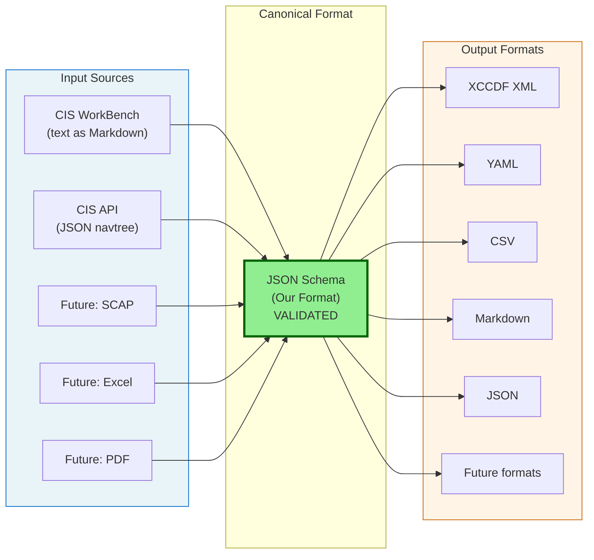
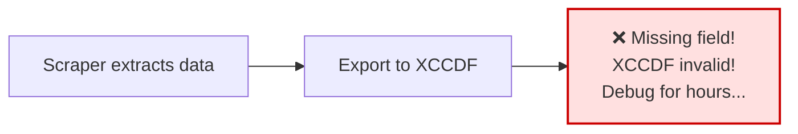
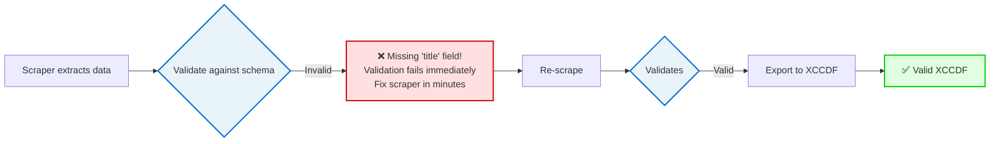

# CIS Benchmark CLI - Data Model and JSON Schema

!!! info "Documentation Path"
    **You are here:** Technical Reference > Data Model

    - **For architecture:** See [Architecture Overview](../developer-guide/architecture.md)
    - **For data flow:** See [Data Flow Pipeline](../developer-guide/data-flow-pipeline.md)

## Overview

This document defines our **canonical data format** for CIS benchmarks. All data flows through this format.

## Data Flow Architecture



**KEY PRINCIPLE:** Every exporter takes a `Benchmark` object, so every benchmark is validated by the `Benchmark` model before it is exported to any format. The JSON Schema is generated from that model (see [Validation](#validation)).

## Why JSON Schema as Canonical Format?

### Benefits

**Single Source of Truth**

- All exporters map from ONE format
- No exporter-specific logic in scraper
- Clear contract between components

**Validation**

- Ensure scraped data is complete
- Catch extraction errors early
- Verify required fields present

**Documentation**

- Self-documenting data format
- Clear field definitions
- Type information

**Versioning**

- Schema v1.0, v2.0 as needs evolve
- Backward compatibility tracking
- Migration paths

**Generated from the model**

- The `Benchmark` pydantic model is the source; the schema is generated from it at docs build
- Types and required fields in the schema are the model's

**Testing**

- Validate test fixtures
- Ensure exporters get expected input
- Clear test assertions

## Our JSON Schema

### Location

The schema is generated from the `Benchmark` model when the docs are built, and published with them: [schemas/benchmark.json](../schemas/benchmark.json) (`https://mitre.github.io/cis-bench/schemas/benchmark.json`). It is JSON Schema Draft 2020-12 and names that draft in its `$schema` keyword. The model is its only source, so there is no copy to keep up to date. To print it from an installed cis-bench (without the `$schema` keyword the published file adds):

```bash
python -c "import json; from cis_bench.models.benchmark import Benchmark; print(json.dumps(Benchmark.model_json_schema(), indent=2))"
```

### Structure

A benchmark file is one object: the benchmark's fields (see [Field Definitions](#field-definitions)) and `recommendations`, an array of recommendation objects. A copy saved before `text_format` and `artifact_title_format` existed may leave them out: cis-bench works them out from `scraper_version` when it loads the copy, and the schema accepts such a copy.

## Using JSON Schema

### Validation

cis-bench itself validates a benchmark with the `Benchmark` model when it builds or loads one; it does not read the JSON Schema. The schema checks a file's structure and types. The model also checks what a JSON Schema does not express:

- `total_recommendations` equals the number of items in `recommendations`
- each profile title is defined once in `profile_definitions`

The schema is for other tools that read cis-bench's benchmark files, for example with `jsonschema`:

```python
import json

from jsonschema import Draft202012Validator

with open("benchmark-schema.json") as f:  # schemas/benchmark.json from the docs site
    schema = json.load(f)
with open("23598.json") as f:  # a benchmark file cis-bench wrote
    Draft202012Validator(schema).validate(json.load(f))
```

## Exporter Mapping

Each exporter knows how to map from our canonical format to its target format:

### JSON Exporter
```python
# Simple pass-through (already in our format)
def export(self, data, output_path):
with open(output_path, 'w') as f:
json.dump(data, f, indent=2)
```

### YAML Exporter
```python
# Direct mapping (structure is the same)
def export(self, data, output_path):
with open(output_path, 'w') as f:
yaml.dump(data, f)
```

### CSV Exporter
```python
# Flatten recommendations array
def export(self, data, output_path):
rows = []
for rec in data['recommendations']:
row = {
'benchmark_title': data['title'],
'benchmark_id': data['benchmark_id'],
'ref': rec['ref'],
'title': rec['title'],
# ... flatten all fields
}
rows.append(row)

# Write CSV
with open(output_path, 'w') as f:
writer = csv.DictWriter(f, fieldnames=row.keys())
writer.writeheader()
writer.writerows(rows)
```

### XCCDF Exporter
```python
# Map to xsdata XCCDF models
def export(self, data, output_path):
from cis_bench.models.xccdf import Benchmark, Rule, Status

# Create XCCDF Benchmark
xccdf_benchmark = Benchmark(
id=f"cis_benchmark_{data['benchmark_id']}",
status=[Status(value="draft")],
title=data['title'],
version=data['version']
)

# Map each recommendation XCCDF Rule
for rec in data['recommendations']:
rule = Rule(
id=f"rule_{rec['ref'].replace('.', '_')}",
title=rec['title'],
description=rec['description'], # Markdown, written as stored
# ... map other fields per XCCDF spec
)
xccdf_benchmark.rule.append(rule)

# Serialize to XML
xml_output = xccdf_benchmark.to_xml(pretty_print=True)
with open(output_path, 'w') as f:
f.write(xml_output)
```

## Field Definitions

### Benchmark Level

| Field | Type | Required | Description |
|-------|------|----------|-------------|
| `title` | string | | Full benchmark title |
| `benchmark_id` | string | | CIS WorkBench ID |
| `url` | string (URI) | | Source URL |
| `version` | string | | Benchmark version |
| `published_date` | string (ISO 8601 date) or null | | The date WorkBench shows the release as published, read from the benchmark's page |
| `description` | string or null | | The benchmark's overview, as the Markdown its page gives |
| `profile_definitions` | array | | The benchmark's profiles as its page defines them: `title`, `description` (Markdown; the page gives it as HTML and it is converted as the page is read), `parent` (the title of the profile it extends, or null); each title once; empty for copies saved before they were read |
| `release_type` | string or null | | The kind of release, as the page names it (e.g. `Planned Update`) |
| `contributors` | array of string | | The contributors, in the order the page lists them; a name the page lists twice is kept twice |
| `parent_benchmark_url` | string (URI) or null | | The WorkBench page of the benchmark this one was based on |
| `parent_benchmark_title` | string or null | | The title of the benchmark this one was based on |
| `community_url` | string (URI) or null | | The WorkBench page of the community that maintains the benchmark |
| `milestone_name` | string or null | | The release milestone's name |
| `milestone_url` | string (URI) or null | | The WorkBench page of the release milestone |
| `intended_audience` | string or null | | Who the benchmark is for, as Markdown |
| `acknowledgements` | string or null | | The page's acknowledgements, as Markdown |
| `assets` | array | | The products the benchmark applies to: `title` and `cpe_id` (a CPE 2.3 name) |
| `revision_history` | array | | The page's revision history, newest first: `revised_at` (the time the page shows, with no zone: the page names none), `author`, `modification_count`; each may be null |
| `downloaded_at` | string (ISO 8601) | | When it was downloaded, in UTC with its offset (`Z`); files from earlier versions carry no offset |
| `scraper_version` | string | | Strategy version used |
| `text_format` | `"html"` or `"markdown"` | | The form of the recommendation text fields as written. Every loaded copy holds `markdown`; a copy saved without this field is `html` when its `scraper_version` is `v1_2025_10` (the strategy that saved rendered HTML) and `markdown` otherwise |
| `artifact_title_format` | `"html"` or `"markdown"` | | The form of the artifact titles as written. Every loaded copy holds `markdown`; a copy saved without this field holds the titles as the artifact payload gave them, HTML for some, and is `html` |
| `total_recommendations` | integer | | Count of recommendations |
| `recommendations` | array | | Array of recommendation objects |

The fields from `release_type` to `revision_history` hold what the benchmark's WorkBench page says beyond its recommendations. cis-bench does not read them from the page yet, so every copy has them null or as an empty array; a copy saved before they existed loads the same way. When they are read, a field the page does not give stays null or empty: nothing is filled in.

### Recommendation Level

| Field | Type | Required | Description | Markdown text |
|-------|------|----------|-------------|---------------|
| `ref` | string | | Reference number (e.g., "3.1.1") | No |
| `title` | string | | Recommendation title | No |
| `url` | string (URI) | | Direct link to recommendation | No |
| `assessment_status` | string | | "Automated" or "Manual" | No |
| `profiles` | array of string | | Profiles the rule belongs to | No |
| `cis_controls` | array of object | | CIS Controls v7/v8 mappings with Implementation Groups | No |
| `mitre_mapping` | object/null | | MITRE ATT&CK techniques, tactics, mitigations (lists of IDs) | No |
| `nist_controls` | array of string | | NIST SP 800-53 control IDs | No |
| `parent` | object/null | | Parent recommendation (url, title) | No |
| `artifacts` | array of object | | Test artifacts: `id`, `view_level`, `title` (Markdown: the payload gives some titles as HTML, converted as the payload is read; a copy saved before that is converted once as it loads, by `artifact_title_format`), `status`, `artifact_type` | No |
| `description` | string/null | | Detailed description | Yes |
| `rationale` | string/null | | Justification | Yes |
| `impact` | string/null | | Impact statement | Yes |
| `audit` | string/null | | Audit procedure | Yes |
| `remediation` | string/null | | Remediation steps | Yes |
| `additional_info` | string/null | | Additional information and notes | Yes |
| `default_value` | string/null | | Default config value | Yes |
| `artifact_equation` | string/null | | Artifact equation logic | Yes |
| `references` | string/null | | External references | Yes |

**Markdown text**: these fields hold the Markdown WorkBench gives, with `\n` line breaks,
whichever scraper saved the copy. A copy saved by the v1 scraper (`scraper_version`
`v1_2025_10`) holds the page's rendered HTML instead; `Benchmark` converts it to Markdown as
the copy loads (`cis_bench.utils.markdown_text`, on markdownify), keeping the words,
paragraphs, code blocks, lists, tables, links and placeholders such as `<user>`. The stored
copy is left as it was. Which form a copy holds is read from `text_format` (or, for a copy
saved without that field, from `scraper_version`), never from the text itself: a placeholder
looks like a tag. Artifact titles follow the same rule with `artifact_title_format`: the
payload gives some titles as HTML and the parser converts them as it reads the payload; a
copy saved before that is converted once as it loads. In exports the text is:

- Preserved in JSON/YAML export
- Written as the cell text in CSV export
- Written as it is in Markdown export, with two document-level adjustments: a placeholder in
  prose (outside code) is written `&lt;user>` so a renderer with raw HTML on (GitHub, MkDocs)
  shows it as text instead of reading it as a tag, and a fence a field leaves open is closed
  at the field's end so it cannot swallow the fields after it; both decided by the CommonMark
  parser (markdown-it-py), never by matching the text

- Written as the stored Markdown in the CIS and DISA XCCDF exports (see the style configs)

## Validation Strategy

### When to Validate

1. **After scraping** - Before saving JSON
2. **Before exporting** - Ensure input is valid
3. **In tests** - Validate all fixtures

### Validation Levels

**Strict** (for our saved JSON):

- All required fields present
- Types match schema
- Additional properties not allowed

**Lenient** (for backward compatibility):

- Required fields present
- Types match when present
- Additional properties allowed (ignore)

## Schema Evolution

### Version 1.0.0 (Current)

- Initial schema
- Based on current CIS WorkBench fields
- Includes all 10 recommendation fields

### Version 1.1.0 (Future)

- Add new fields as CIS WorkBench evolves
- Maintain backward compatibility
- Use `oneOf` for version-specific fields

### Version 2.0.0 (Future)

- Breaking changes if needed
- Migration guide provided
- Tool supports both v1 and v2

## Tools and Libraries

**JSON Schema validation** (for tools that read cis-bench's files): `pip install jsonschema`

## Example: Complete Benchmark

```json
{
"title": "CIS Amazon Elastic Kubernetes Service (EKS) Benchmark",
"benchmark_id": "22605",
"url": "https://workbench.cisecurity.org/benchmarks/22605",
"version": "v1.8.0",
"published_date": "2025-08-28",
"description": "This document provides prescriptive guidance for establishing a secure configuration posture for Amazon EKS.",
"downloaded_at": "2025-10-17T21:48:00Z",
"scraper_version": "v1_2025_10",
"total_recommendations": 50,
"recommendations": [
{
"ref": "3.1.1",
"title": "Ensure that the kubeconfig file permissions are set to 644 or more restrictive",
"url": "https://workbench.cisecurity.org/sections/3511915/recommendations/5772605",
"assessment": "<p>Automated assessment available</p>",
"description": "<p>If kubelet is running, and if it is configured by a kubeconfig file...</p>",
"rationale": "<p>Improper access permissions could allow...</p>",
"impact": "<p>None expected</p>",
"audit": "<p>Run the following command: <code>stat -c %a /var/lib/kubelet/kubeconfig</code></p>",
"remediation": "<p>Run: <code>chmod 644 /var/lib/kubelet/kubeconfig</code></p>",
"default_value": null,
"artifact_eq": null,
"mitre_mapping": "<p>T1574.006 - Hijack Execution Flow: Dynamic Linker Hijacking</p>",
"references": "<ul><li>Kubernetes documentation</li></ul>"
}
// ... 49 more recommendations
]
}
```

## Integration with Exporters

### BaseExporter Contract

```python
class BaseExporter(ABC):
@abstractmethod
def export(self, data: dict, output_path: str) -> str:
"""Export benchmark data.

Args:
data: Dictionary matching the benchmark JSON Schema
output_path: Where to write output

Returns:
Path to created file

Raises:
jsonschema.ValidationError: If data doesn't match schema
IOError: If file cannot be written
"""
# All exporters should validate input first
self._validate_input(data)

# Then perform export
# ...
```

### Mapping Examples

**JSON Schema Field XCCDF Field**

| Our Schema | XCCDF Element | Notes |
|------------|---------------|-------|
| `ref` | `Rule/@id` | Convert "3.1.1" "rule_3_1_1" |
| `title` | `Rule/title` | Direct mapping |
| `description` | `Rule/description` | The stored Markdown, written as it is; in the CIS style the default value and the additional information follow it as labelled sections |
| `rationale` | `Rule/rationale` | The stored Markdown, written as it is |
| `audit` | `Rule/check/check-content` | The stored Markdown, inside the check element |
| `remediation` | `Rule/fixtext` | The stored Markdown, written as it is |
| `references` | `Rule/ident[@system="URL"]` | CIS style: one ident per non-empty line, as stored |
| `mitre_mapping` | `Rule/reference` | Parse and map to reference elements |

**JSON Schema Field CSV Column**

All fields flattened to single row:
```csv
benchmark_title,benchmark_id,ref,title,description,audit,...
"CIS Amazon EKS","22605","3.1.1","Ensure...","If kubelet...","Run...",...
```

## Validation Implementation

The scraper builds a `Benchmark`, so pydantic validates every field as the benchmark is made; `deserialize_benchmark_json` validates a stored copy the same way when it loads. Exporters receive a validated `Benchmark`. The JSON Schema is generated from that same model and is not used at runtime.

## Benefits in Practice

### Before (No Schema)



### After (With Schema)



---
